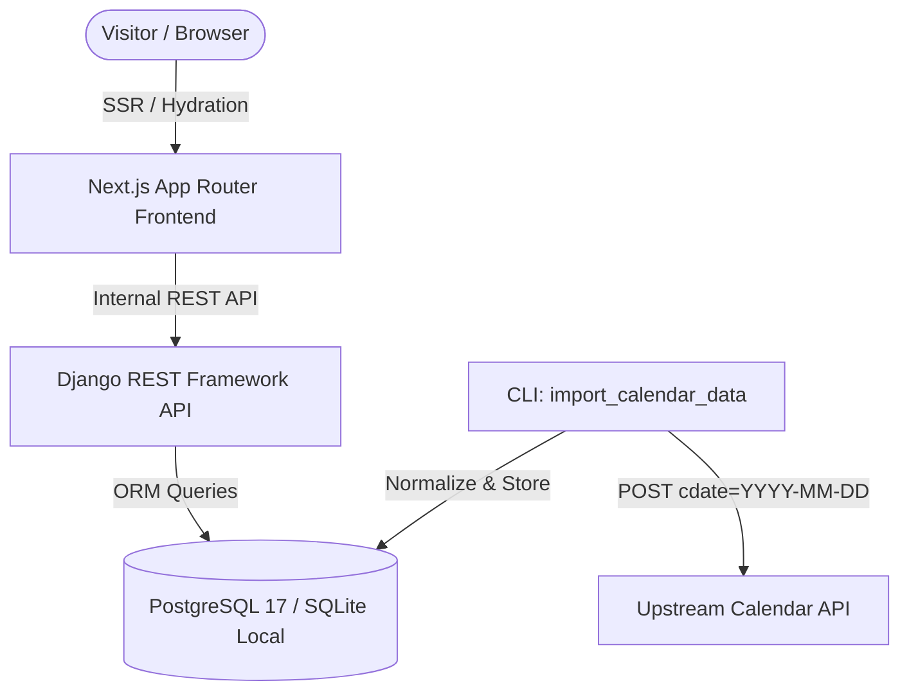

# Namma Tamil Calendar (நம்ம தமிழ் காலண்டர்)

> **Domain:** https://nammatamilcalendar.in  
> A high-performance, accessible, bilingual Tamil Daily Calendar, Panchangam, Muhurtham & Festival web platform.

---

## 1. System Architecture



### Key Highlights:
- **Resilient Offline Architecture**: All calendar views are served directly from the normalized local database; client requests never depend synchronously on external APIs.
- **Bi-lingual Native Support**: Complete Tamil (தமிழ்) and English localization across all pages, navigation, Panchangam labels, and feedback forms.
- **Dual Themes**: Accessible Light and Dark modes with persistent storage and system preference detection.
- **Unique Agal Vilakku Loader**: Custom lightweight SVG oil lamp animation with a gently flickering golden flame.
- **SEO & Search Quality**: Dynamic metadata per date/month/year, canonical URLs, XML sitemaps, robots.txt, and Schema.org JSON-LD structured data.
- **Google AdSense Ready**: Pre-configured non-intrusive ad containers with reserved heights to eliminate Cumulative Layout Shift (CLS).

---

## 2. Technology Stack

- **Frontend**: Next.js (App Router), React 19, TypeScript, Tailwind CSS, Lucide Icons.
- **Backend**: Python 3.14 / 3.12, Django 5/6, Django REST Framework, `psycopg` 3.
- **Database**: PostgreSQL 17 (production), SQLite (zero-config local dev fallback).
- **Tooling**: Docker & Docker Compose, ESLint.

---

## 3. Quick Start (Local Development)

### 3.1 Backend Setup (Django)

```bash
# Navigate to backend directory
cd backend

# Activate virtual environment (Windows PowerShell)
..\venv\Scripts\Activate.ps1

# Install requirements (if needed)
pip install -r requirements.txt

# Run migrations
python manage.py migrate

# (Optional) Import sample calendar data
python manage.py import_calendar_data --start-date 2026-10-14 --end-date 2026-10-18

# Start the Django development server
python manage.py runserver 127.0.0.1:8000
```

The Django REST API will be available at `http://127.0.0.1:8000/api/v1/`.

### 3.2 Frontend Setup (Next.js)

```bash
# Navigate to frontend directory
cd frontend

# Install dependencies (if needed)
npm install

# Start the Next.js dev server
npm run dev
```

The frontend application will be running at `http://localhost:3000/`.

---

## 4. Calendar Data Import Pipeline

The backend includes an idempotent management command `import_calendar_data`:

```bash
python manage.py import_calendar_data --start-date 2025-01-01 --end-date 2026-12-31
```

### Options:
- `--start-date YYYY-MM-DD`: Start date of import range (default: `2025-01-01`).
- `--end-date YYYY-MM-DD`: End date of import range (default: `2026-12-31`).
- `--force`: Force re-importing already existing dates in the database.
- `--dry-run`: Fetch and validate without persisting records to the database.
- `--delay SECONDS`: Delay between HTTP requests to respect upstream rate limits (default: `0.05`).
- `--batch-size N`: Batch interval for reporting progress (default: `50`).

---

## 5. REST API Endpoints

| Endpoint | Method | Description |
| :--- | :---: | :--- |
| `/api/v1/calendar/today/` | `GET` | Today's full calendar details (Asia/Kolkata timezone) |
| `/api/v1/calendar/day/?date=YYYY-MM-DD` | `GET` | Specific day calendar details (Panchangam, Timings, Rasi Palan) |
| `/api/v1/calendar/month/?year=YYYY&month=MM` | `GET` | All days summary for given month |
| `/api/v1/calendar/year/?year=YYYY` | `GET` | 12-month summary breakdown and statistics |
| `/api/v1/festivals/` | `GET` | Filterable list of festivals and observances |
| `/api/v1/festivals/upcoming/` | `GET` | Next 15 upcoming festivals starting from today |
| `/api/v1/muhurtham-dates/` | `GET` | Auspicious wedding / Suba Muhurtham dates |
| `/api/v1/feedback/` | `POST` | User feedback submission with anti-spam rate hashing |

---

## 6. Automated Testing

### Backend Unit & Integration Tests
```bash
cd backend
python manage.py test
```
*Current test suite covers CalendarDay lookups, invalid date validations, month/year aggregations, festivals, Muhurtham endpoints, normalizer service, and feedback validation.*

### Frontend Production Build Check
```bash
cd frontend
npm run build
```
*Validates static generation, server-rendered components, dynamic routes, and TypeScript type-checking.*

---

## 7. Docker Deployment

To launch the complete stack (PostgreSQL 17, Django backend, and Next.js frontend) with Docker Compose:

```bash
docker compose up --build -d
```
